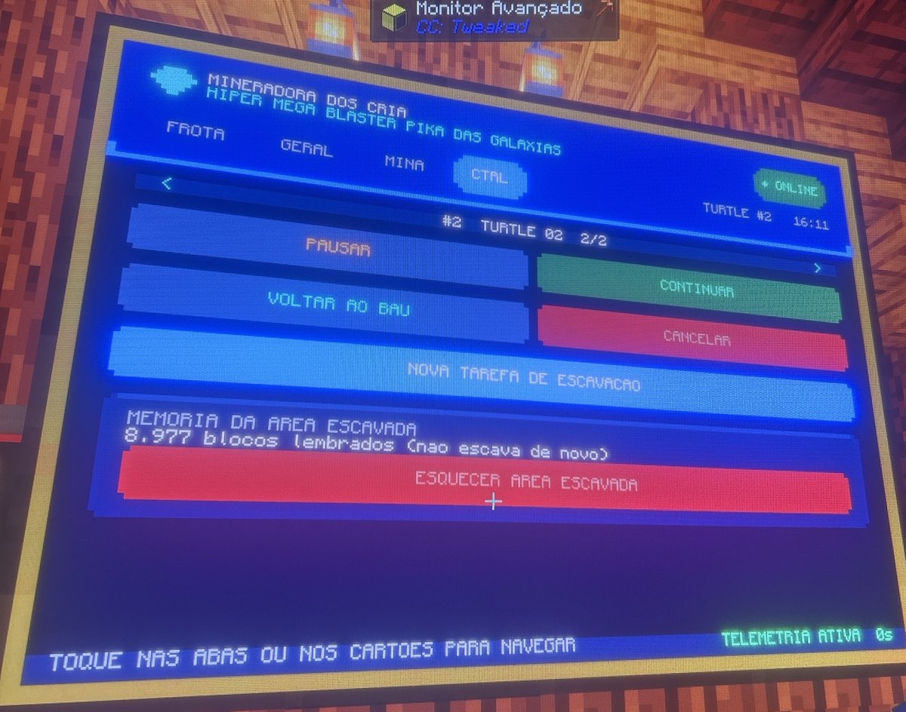
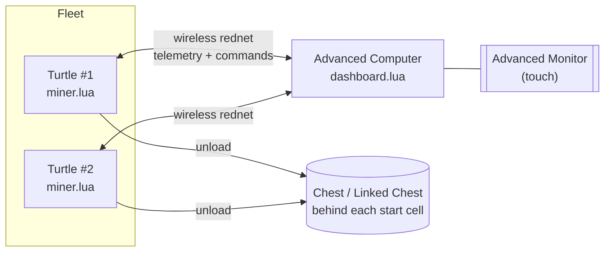
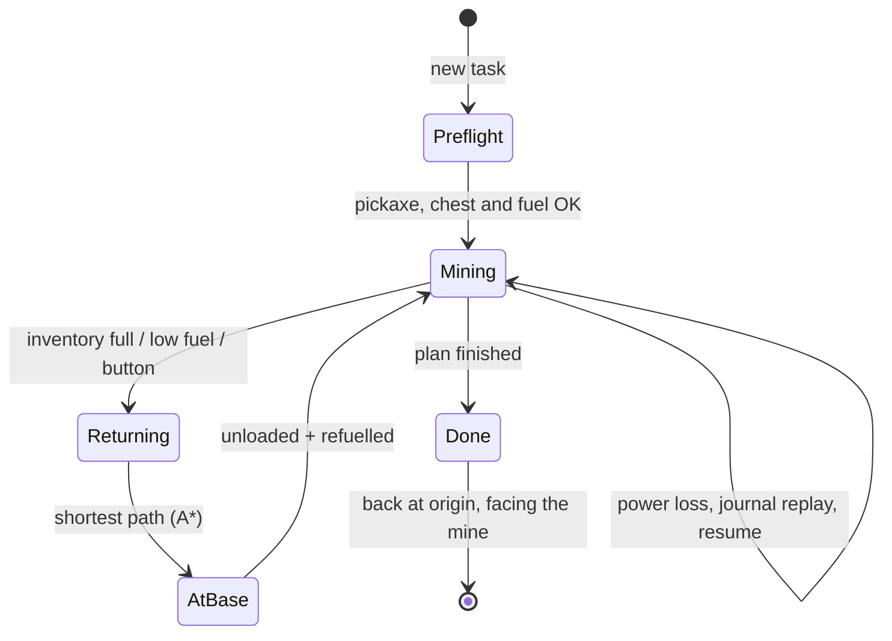

<div align="center">

# DeepDelve: Minecraft Mining Turtles

Autonomous mining turtles for **Minecraft**, built on the **CC: Tweaked** mod and controlled by touch from an Advanced Monitor.<br>
They always walk back to their chest, remember what they already dug, and survive power cuts.


[Quick start](#quick-start) ·
[What it does](#what-it-does) ·
[Compatibility](#compatibility) ·
[Using the dashboard](#using-the-dashboard) ·
[How it works](#how-it-works) ·
[Configuration](#configuration) ·
[Limitations](#known-limitations) ·
[Português](README.pt-BR.md)

</div>

```text
-- on the turtle:                         -- on the dashboard computer:
wget https://raw.githubusercontent.com/   wget https://raw.githubusercontent.com/
  jonasssgabriel/deepdelve/main/            jonasssgabriel/deepdelve/main/
  src/miner.lua miner                       src/dashboard.lua dashboard
miner                                     dashboard
```

<div align="center">
  
  <br>
  <sub>The CONTROL page running on a real server (photo taken in-game, earlier branding; the title is a one-line setting)</sub>
</div>

---

## What it does

You place a turtle, put a chest **right behind it**, walk to a monitor and tell the turtle how far to dig in each direction. It does the rest.

- **Margin-based excavation.** You give five numbers: blocks to the **left**, **right**, **front**, **up** and **down** of the turtle. The turtle can start on the left edge, in the middle or on the right edge of the hole, just by changing the margins.
- **Always returns home.** Whenever the inventory is full, fuel gets low, or you press a button, the turtle takes the **shortest known path** back to the chest (A\*, not a retrace of its trail), unloads, refuels and goes back to work.
- **Never strands itself.** Before every step it checks that it still has enough fuel to get back, with a safety margin.
- **Survives crashes.** A write-ahead journal records each move *before* it happens. After a server restart or power loss the turtle works out where it really is and resumes.
- **Remembers what it dug.** Cleared cells are stored (run-length encoded). A new task that overlaps old work skips it. Want to go 20 blocks deeper in a hole you already dug? Just raise the *down* margin.
- **Learns from what it sees.** Empty space it passes (caves, old tunnels) counts as already dug and becomes a shortcut for routing.
- **Plays nicely with other turtles.** A turtle in the way is treated as a temporary obstacle: it waits, reroutes, and never breaks the other turtle.
- **Handles hazards.** Lava and water are sealed with cobblestone/dirt, chests/spawners/bedrock are skipped, unbreakable modded blocks are detected after a few failed swings, falling gravel is handled.
- **Never litters.** It does not drop items on the ground. With no chest, or a full chest, it waits and shows a warning.
- **Fleet dashboard.** One monitor, many turtles: fleet list, fuel and inventory, live progress with ETA and a per-layer map, and a task wizard. All by touch.

## Compatibility

DeepDelve is **pure Lua on top of the CC: Tweaked API**. It does not need any other mod.

| Piece | Status |
|---|---|
| **CC: Tweaked** (turtles, wireless modems, advanced monitors) | **Required.** Developed and used on **1.120.2 for Fabric, Minecraft 26.2**. It only uses the Lua API, so Forge/NeoForge builds and other Minecraft versions should work as long as CC: Tweaked is reasonably recent (not verified on them). |
| **Mining turtle** (any turtle + a pickaxe) | Required. A normal turtle holds 20,000 fuel, an Advanced turtle 100,000. |
| **Wireless modem** on the turtle and on the dashboard computer | Required for the dashboard. Range is limited by the server (`modem_range`, 64 blocks in my setup). |
| **Advanced Monitor** + Advanced Computer | Required for the dashboard (touch + colour). The turtle itself does not need the dashboard to dig. |
| **Chest, barrel, Linked Chest, shulker, ender chest, storage-drawer style blocks** | Any block whose id contains `chest`, `barrel`, `linked`, `shulker`, `drawer`, `ender` or `storage` is accepted as the home inventory. Any peripheral that reports itself as an `inventory` also works. The list is a one-line setting. Vanilla chests and Linked Chests are what it was built for; run `diagnostic.lua` to confirm yours. |
| **Chunk loaders** (a chunk-loader mod, FTB Chunks, vanilla `/forceload`, ...) | Optional but important: a turtle stops when its chunk unloads. Load the chunk the mine is in. |
| **Modded ores and blocks** | Anything breakable is dug. Nothing depends on ore tags. Block names to *skip* (protected) or use as *sealing material* are lists at the top of `miner.lua`. |
| **Advanced Peripherals, other turtle upgrades** | Not needed and not used. |
| **Other DeepDelve turtles** | Fully supported (fleet view, collision avoidance). Memory is per turtle for now, see [limitations](#known-limitations). |

The in-game dashboard text is in **Portuguese** (`FROTA`, `GERAL`, `MINA`, `CTRL`); the code comments and this documentation are in English.

## Quick start

### 1. Build the setup

```
          back                      front (the mine)
   +-----+-----+                  
   |chest| T   |  ->  T = turtle, looking at the mine.
   +-----+-----+      The chest must be on the cell right BEHIND the turtle.
```

- Turtle with a **pickaxe** and a **wireless modem**.
- A **chest (or Linked Chest)** immediately behind it.
- Optional: an auxiliary fuel chest next to the start cell (see `AUX_LADO`).

### 2. Install the programs

Either drag the files onto the computer screen, or download them (the server must allow HTTP to GitHub):

```bash
# on every turtle
wget https://raw.githubusercontent.com/jonasssgabriel/deepdelve/main/src/miner.lua miner

# on the Advanced Computer that has the monitor and a wireless modem
wget https://raw.githubusercontent.com/jonasssgabriel/deepdelve/main/src/dashboard.lua dashboard
```

Start them with `miner` and `dashboard`. To start automatically after a reboot, create a `startup.lua` containing `shell.run("miner")` (or `shell.run("dashboard")`).

> [!TIP]
> Give each turtle a name with `label set Quarry-1`. The dashboard shows it.

### 3. Dig

On the monitor: **CTRL → NOVA TAREFA DE ESCAVACAO** (new excavation task). Pick a preset or set the margins, press **INICIAR ESCAVACAO** (start). **Try a 3x3x3 first.**

### 4. Check your world (optional)

`diagnostic.lua` is a small test program for the turtle: wireless modem range, whether your chest type is recognised (including Linked Chests), the block tags the turtle can see, and a chunk loader placement test. Run `diagnostic eco` on the dashboard computer first, then `diagnostic` on the turtle. It writes `diagnostic.txt`.

## Using the dashboard

Everything is touch. Tap the tabs or the cards.

| Page | What you see |
|---|---|
| **FROTA** (fleet) | Every turtle that is broadcasting: name, status, fuel, progress. Tap one to open it. |
| **GERAL** (overview) | Fuel gauge, free slots, what has been stored in the chest, event history. |
| **MINA** (mine) | Progress, estimated time left, and a live **map of the current layer** (`B` marks the chest). |
| **CTRL** (control) | **PAUSAR** pause · **CONTINUAR** resume · **VOLTAR AO BAU** return to the chest and wait there · **CANCELAR** abort (two taps, it still walks home) · **NOVA TAREFA** new task · **ESQUECER AREA** forget the dug-area memory. |

The task wizard has:

- **Presets:** cube 3x3x3, rooms, tunnel, shaft... or free mode.
- **Turtle sits on:** left / middle / right of the width.
- **Margins:** left, right, front, up, down (up to 119 each; max 130 per side and 100,000 blocks in total).
- **Order:** auto, top-down or bottom-up.
- **Memory:** use it (default) or ignore what was already dug.

### Going deeper in an old hole

Memory makes this trivial. Open a new task with the **same** margins and a larger **down** value. The turtle walks through the cleared part and digs only the new part. Don't press *ESQUECER*, or it will redo everything.

## How it works



### Coordinates

Each turtle works in its **own frame**. The origin `(0,0,0)` is the cell where you placed it, the chest sits at `(0,0,-1)`, and the turtle always ends a job on the origin facing the mine, with its back to the chest. If you place it facing the wrong way, the pre-flight check rotates until it finds the chest and corrects its heading.

### A job, from start to finish



### Planning

1. The box is cut into **bands of 3 layers**. The turtle travels along the middle layer and digs **up and down** at every step, so one pass clears three layers.
2. Each band is swept in a **snake pattern**. The planner tries both axes and both starting sides and keeps the cheapest.
3. Order is `auto` (shorter side first), `cima` (top-down) or `baixo` (bottom-up).
4. The plan is then filtered by **memory**: steps that would clear nothing new are dropped.

### Safety and crash recovery

<details open>
<summary>Design decisions</summary>

| Decision | Why | What would break without it |
|---|---|---|
| Journal written **before** each move/turn | After a crash the turtle compares its saved fuel with the current fuel to know whether the move happened | Position drifts, the turtle can no longer find the chest |
| Heading ambiguity resolved by probing neighbours | A turn leaves no fuel trace | Wrong heading after a crash |
| Fuel reserve `ceil(distance × 1.25) + 20` checked before every step | A turtle must never be too far to return | Stranded turtles |
| Unload at ≤2 free slots, or ≤5 free when the chest is within 10 blocks | Avoids both overflow and pointless trips | Mining stalls on a full inventory |
| Coal and lava found while mining are used on the spot | No trip home just to refuel | More trips |
| Items are only dropped into a **verified** inventory | Never spill loot | Items on the floor |
| Unlimited-fuel servers enter a safe mode | Fuel can't be used to infer movement | Position ambiguity after crashes |
| Another turtle = *temporary* block | It will move; skipping the cell forever would leave holes | Holes, or breaking the other turtle |
| Unbreakable block = 4 failed swings, then treated as protected | Covers modded bedrock and barriers | Endless digging retries |

</details>

<details>
<summary>Routing (A*) details</summary>

- State = `(cell, heading)`. Turning costs 0.15, moving through a known empty cell costs 1, through solid rock 3.5 (digging is slow).
- Cells inside the box are diggable, cells outside are not, unless the turtle has *seen* them empty.
- Blocked cells expire after a few seconds when the cause was another turtle.
- Verified against a brute-force Dijkstra oracle in the simulator (120 random cases, identical optimal cost).

</details>

<details>
<summary>Memory</summary>

- Cleared cells are saved as run-length pairs in `deepdelve_memory.dat`.
- A frozen copy is taken when a job starts so the plan is stable if the turtle restarts mid-job.
- Empty cells seen at the front, above and below the turtle are added for free.
- `ESQUECER AREA ESCAVADA` wipes it. Do that if you move the chest or rebuild the area.

</details>

## Configuration

Constants live at the top of each file.

| Setting (`miner.lua`) | Default | Meaning |
|---|---|---|
| `SENHA` | `nil` | Shared password for remote commands. Use the same value in both programs. |
| `LIMITE_DIM`, `LIMITE_TOTAL` | `130`, `100000` | Max size per side / total blocks of one task. |
| `AUTO_REFUEL` | `true` | Burn fuel found in the inventory. |
| `AUTO_RETOMAR` | `true` | Resume the job after a reboot. |
| `AUX_LADO` | `nil` | `'cima'` `'baixo'` `'esq'` `'dir'`: side of the start cell with an auxiliary **fuel chest**. |
| `VIES_MEIO` | `'esq'` | Which way to lean when the start cell is the middle of an even width. |
| `PESO_GIRO`, `PESO_ESCAVAR` | `0.15`, `2.5` | Routing costs for turning and for digging. |
| `RESERVA_COMB`, `MARGEM_COMB` | `20`, `1.25` | Fuel reserve when returning. |
| `SLOTS_LIVRES_MIN` | `2` | Free slots left before it goes to unload. |
| `MANTER_COMBUSTIVEL`, `MANTER_SELO` | `32`, `32` | Fuel and sealing blocks the turtle keeps for itself. |
| `BAUS`, `SELOS`, `LIQUIDOS`, `PROTEGIDOS` | lists | Substring lists: accepted home inventories, sealing blocks, liquids, blocks never to touch. |

| Setting (`dashboard.lua`) | Default | Meaning |
|---|---|---|
| `TITULO`, `SUBTITULO` | `DEEPDELVE` ... | Header text on the monitor. |
| `SENHA` | `nil` | Must match the turtles. |
| `APENAS_IDS` | `nil` | Only show these computer ids, e.g. `{0, 3, 7}`. |
| `TEMPO_OFFLINE` | `8` | Seconds without a packet before a turtle shows OFFLINE. |

### Protocol

Telemetry is broadcast on `doscria.status.v1`; commands use `doscria.comando.v6` and replies `doscria.resposta.v6` (names kept from the original project so existing setups keep working). Commands: `ping`, `escavar`, `pausar`, `continuar`, `cancelar`, `voltar`, `esquecer`.

## Repository layout

```
deepdelve/
├── src/
│   ├── miner.lua        # runs on every turtle
│   ├── dashboard.lua    # runs on the monitor computer
│   └── diagnostic.lua   # optional in-game test tool
├── docs/img/            # screenshots
├── README.md
├── README.pt-BR.md      # same documentation in Portuguese
└── LICENSE
```

## Known limitations

- **Memory is per turtle.** Every turtle has its own coordinate frame, so they can't yet exchange "cleared" maps. A possible next step is using GPS hosts to give all turtles a common frame.
- **No lighting.** The holes are dark and monsters spawn in them. Automatic torch placement is planned. Meanwhile, turn off mob spawning on your server or light the area yourself.
- **Not a speed hack.** CC: Tweaked has no tool-speed upgrades. Use more turtles instead.
- **Needs a loaded chunk.** If the chunk unloads the turtle stops, and resumes when it loads again.
- **Tested mostly in a simulator.** A Lua mock of the turtle API drove hundreds of randomised jobs (every start position, crash at random moments, full chest, no chest, lava, bedrock, other turtles) and the A* was checked against an oracle. It is also running on a real Fabric server, but use a small area first and keep an eye on it.

## Roadmap

- Shared map between turtles (GPS frame)
- Automatic torches
- Portable Linked Chest unloading (no trips home)
- Splitting one big job across several turtles
- Ore-vein mode (follow ores by tag)

## License

[MIT](LICENSE)
