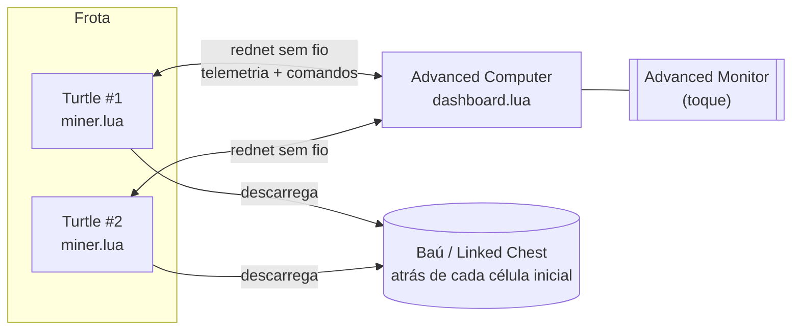
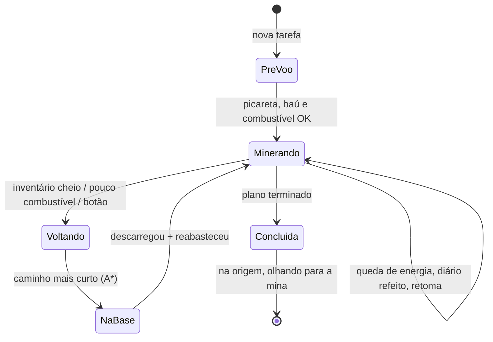

<div align="center">

# DeepDelve

Turtles de mineração autônomas para o **CC: Tweaked**, controladas por toque num Advanced Monitor.<br>
Elas sempre voltam ao baú, lembram o que já escavaram e sobrevivem a quedas de energia.


[Começo rápido](#começo-rápido) ·
[O que faz](#o-que-faz) ·
[Compatibilidade](#compatibilidade) ·
[Usando o painel](#usando-o-painel) ·
[Como funciona](#como-funciona) ·
[Configuração](#configuração) ·
[Limitações](#limitações-conhecidas) ·
[English](README.md)

</div>

```text
-- na turtle:                              -- no computador do painel:
wget https://raw.githubusercontent.com/    wget https://raw.githubusercontent.com/
  jonasssgabriel/deepdelve/main/             jonasssgabriel/deepdelve/main/
  src/miner.lua miner                        src/dashboard.lua dashboard
miner                                      dashboard
```

<div align="center">
  
  <br>
  <sub>A página CTRL rodando num servidor de verdade (foto tirada no jogo, com a marca antiga; o título é uma configuração de uma linha)</sub>
</div>

---

## O que faz

Você coloca uma turtle, põe um baú **bem atrás dela**, vai até o monitor e diz até onde ela deve cavar em cada direção. O resto é com ela.

- **Escavação por margens.** Você informa cinco números: blocos à **esquerda**, à **direita**, à **frente**, para **cima** e para **baixo** da turtle. Ela pode começar na borda esquerda, no meio ou na borda direita do buraco, só mudando as margens.
- **Sempre volta para casa.** Com o inventário cheio, pouco combustível ou um clique no painel, a turtle faz o **caminho mais curto conhecido** até o baú (A\*, e não refazer a trilha), descarrega, reabastece e volta ao trabalho.
- **Nunca fica presa.** Antes de cada passo ela confere se ainda tem combustível para voltar, com folga de segurança.
- **Sobrevive a quedas.** Um diário grava cada movimento *antes* dele acontecer. Depois de reiniciar o servidor ou faltar energia, a turtle descobre onde está de verdade e retoma.
- **Lembra o que já cavou.** As células limpas ficam guardadas (comprimidas em faixas). Uma tarefa nova que sobreponha o trabalho antigo pula essa parte. Quer descer mais 20 blocos num buraco que já existe? É só aumentar a margem *baixo*.
- **Aprende com o que vê.** Espaço vazio por onde ela passa (cavernas, túneis antigos) conta como já escavado e vira atalho nas rotas.
- **Convive com outras turtles.** Uma turtle no caminho é um obstáculo temporário: ela espera, desvia e nunca quebra a outra.
- **Lida com perigos.** Lava e água são seladas com pedra ou terra, baús, spawners e bedrock são pulados, blocos inquebráveis de mods são detectados após algumas tentativas, e cascalho caindo é tratado.
- **Não suja o chão.** Ela não joga itens no chão. Sem baú, ou com o baú cheio, ela espera e mostra um aviso.
- **Painel da frota.** Um monitor, várias turtles: lista da frota, combustível e inventário, progresso ao vivo com tempo restante e mapa por camada, e um assistente de tarefas. Tudo por toque.

## Compatibilidade

O DeepDelve é **Lua puro sobre a API do CC: Tweaked**. Não precisa de nenhum outro mod.

| Peça | Situação |
|---|---|
| **CC: Tweaked** (turtles, modems sem fio, advanced monitors) | **Obrigatório.** Desenvolvido e usado na **1.120.2 para Fabric, Minecraft 26.2**. Usa só a API Lua, então as versões Forge/NeoForge e outras versões do Minecraft devem funcionar se o CC: Tweaked for razoavelmente recente (não verificado nelas). |
| **Turtle de mineração** (qualquer turtle + picareta) | Obrigatória. Turtle comum guarda 20.000 de combustível, a Advanced 100.000. |
| **Wireless Modem** na turtle e no computador do painel | Necessário para o painel. O alcance é limitado pelo servidor (`modem_range`, 64 blocos no meu caso). |
| **Advanced Monitor** + Advanced Computer | Necessários para o painel (toque + cores). A turtle em si não precisa do painel para escavar. |
| **Baú, barril, Linked Chest, shulker, ender chest, blocos estilo storage drawer** | Qualquer bloco cujo id contenha `chest`, `barrel`, `linked`, `shulker`, `drawer`, `ender` ou `storage` serve como inventário base. Qualquer periférico que se declare `inventory` também funciona. A lista é uma configuração de uma linha. Baús comuns e Linked Chests são o alvo do projeto; rode o `diagnostic.lua` para confirmar o seu. |
| **Chunk loaders** (mod de chunk loader, FTB Chunks, `/forceload` do vanilla, ...) | Opcional, mas importante: a turtle para quando o chunk descarrega. Carregue o chunk da mina. |
| **Minérios e blocos de mods** | Tudo que for quebrável é escavado. Nada depende de tags de minério. Os nomes de blocos a *pular* (protegidos) ou usar como *material de selo* são listas no topo do `miner.lua`. |
| **Advanced Peripherals, outros upgrades de turtle** | Não são necessários nem usados. |
| **Outras turtles DeepDelve** | Totalmente suportado (visão da frota, desvio de colisão). A memória é por turtle por enquanto, veja as [limitações](#limitações-conhecidas). |

O texto do painel no jogo está em **português** (`FROTA`, `GERAL`, `MINA`, `CTRL`); os comentários do código e a documentação principal estão em inglês.

## Começo rápido

### 1. Monte o cenário

```
          atrás                     frente (a mina)
   +-----+-----+
   | baú | T   |  ->  T = turtle, olhando para a mina.
   +-----+-----+      O baú fica na célula logo ATRÁS da turtle.
```

- Turtle com **picareta** e **wireless modem**.
- Um **baú (ou Linked Chest)** imediatamente atrás dela.
- Opcional: um baú auxiliar de combustível ao lado da célula inicial (veja `AUX_LADO`).

### 2. Instale os programas

Arraste os arquivos para a tela do computador, ou baixe (o servidor precisa permitir HTTP para o GitHub):

```bash
# em cada turtle
wget https://raw.githubusercontent.com/jonasssgabriel/deepdelve/main/src/miner.lua miner

# no Advanced Computer com o monitor e um wireless modem
wget https://raw.githubusercontent.com/jonasssgabriel/deepdelve/main/src/dashboard.lua dashboard
```

Inicie com `miner` e `dashboard`. Para iniciar sozinho após reiniciar, crie um `startup.lua` com `shell.run("miner")` (ou `shell.run("dashboard")`).

> [!TIP]
> Dê um nome a cada turtle com `label set Mina-1`. O painel mostra esse nome.

### 3. Escave

No monitor: **CTRL → NOVA TAREFA DE ESCAVACAO**. Escolha uma predefinição ou ajuste as margens e toque em **INICIAR ESCAVACAO**. **Teste primeiro com 3x3x3.**

### 4. Confira seu mundo (opcional)

O `diagnostic.lua` é um programa de teste para a turtle: alcance do modem, se o seu tipo de baú é reconhecido (inclusive Linked Chest), as tags de bloco que a turtle enxerga e um teste de colocação de chunk loader. Rode `diagnostic eco` no computador do painel primeiro e depois `diagnostic` na turtle. Ele grava o `diagnostic.txt`.

## Usando o painel

Tudo é por toque. Toque nas abas ou nos cartões.

| Página | O que aparece |
|---|---|
| **FROTA** | Todas as turtles transmitindo: nome, status, combustível, progresso. Toque numa para abrir. |
| **GERAL** | Medidor de combustível, slots livres, o que já foi guardado no baú, histórico de eventos. |
| **MINA** | Progresso, tempo restante estimado e **mapa ao vivo da camada atual** (`B` marca o baú). |
| **CTRL** | **PAUSAR** · **CONTINUAR** · **VOLTAR AO BAU** (volta e espera lá) · **CANCELAR** (dois toques; ela ainda volta para casa) · **NOVA TAREFA DE ESCAVACAO** · **ESQUECER AREA ESCAVADA**. |

O assistente de tarefa tem:

- **Predefinições:** cubo 3x3x3, salas, túnel, poço... ou modo livre.
- **Turtle fica na:** esquerda / meio / direita da largura.
- **Margens:** esquerda, direita, frente, cima, baixo (até 119 cada; máximo de 130 por lado e 100.000 blocos no total).
- **Ordem:** automática, de cima para baixo ou de baixo para cima.
- **Memória:** usar (padrão) ou ignorar o que já foi escavado.

### Descendo mais num buraco antigo

A memória deixa isso simples. Abra uma tarefa nova com as **mesmas** margens e um valor de **baixo** maior. A turtle passa pela parte já limpa e escava só a parte nova. Não toque em *ESQUECER*, senão ela refaz tudo.

## Como funciona



### Coordenadas

Cada turtle trabalha no **seu próprio referencial**. A origem `(0,0,0)` é a célula onde você a colocou, o baú fica em `(0,0,-1)`, e ela sempre termina a tarefa na origem, olhando para a mina, de costas para o baú. Se você a colocar virada para o lado errado, o pré-voo gira até achar o baú e corrige a direção.

### Uma tarefa do início ao fim



### Planejamento

1. A caixa é cortada em **faixas de 3 camadas**. A turtle anda pela camada do meio e escava **para cima e para baixo** a cada passo, então uma passada limpa três camadas.
2. Cada faixa é varrida em **serpentina**. O planejador testa os dois eixos e os dois lados de partida e fica com o mais barato.
3. A ordem é `auto` (lado menor primeiro), `cima` (de cima para baixo) ou `baixo` (de baixo para cima).
4. O plano é filtrado pela **memória**: passos que não limpariam nada novo são descartados.

### Segurança e recuperação de queda

<details open>
<summary>Decisões de projeto</summary>

| Decisão | Por quê | O que quebraria sem ela |
|---|---|---|
| Diário gravado **antes** de cada movimento/giro | Após uma queda, a turtle compara o combustível salvo com o atual para saber se o movimento aconteceu | A posição se perde e ela não acha mais o baú |
| Direção ambígua resolvida olhando os vizinhos | Um giro não deixa rastro no combustível | Direção errada após queda |
| Reserva de combustível `ceil(distância × 1,25) + 20` antes de cada passo | A turtle nunca pode ficar longe demais para voltar | Turtles presas |
| Descarrega com ≤2 slots livres, ou ≤5 se o baú estiver a até 10 blocos | Evita estourar o inventário e viagens inúteis | Mineração travada com inventário cheio |
| Carvão e lava achados na mineração são usados na hora | Não precisa voltar só para reabastecer | Mais viagens |
| Itens só são largados num inventário **verificado** | Nunca derrama o loot | Itens no chão |
| Servidores com combustível ilimitado entram em modo seguro | O combustível não serve para inferir movimento | Ambiguidade de posição após quedas |
| Outra turtle = bloqueio *temporário* | Ela vai sair; pular a célula para sempre deixaria buracos | Buracos, ou quebrar a outra turtle |
| Bloco inquebrável = 4 tentativas falhas, depois tratado como protegido | Cobre bedrock e barreiras de mods | Tentativas de escavação sem fim |

</details>

<details>
<summary>Detalhes das rotas (A*)</summary>

- Estado = `(célula, direção)`. Girar custa 0,15, andar por célula vazia conhecida custa 1, por rocha sólida 3,5 (cavar é lento).
- Células dentro da caixa podem ser cavadas; fora dela não, a menos que a turtle as tenha *visto* vazias.
- Células bloqueadas por outra turtle expiram depois de alguns segundos.
- Verificado contra um oráculo Dijkstra de força bruta no simulador (120 casos aleatórios, mesmo custo ótimo).

</details>

<details>
<summary>Memória</summary>

- As células limpas são salvas como pares de faixas em `deepdelve_memory.dat`.
- Uma cópia congelada é feita quando a tarefa começa, para o plano ficar estável se a turtle reiniciar no meio.
- Células vazias vistas à frente, acima e abaixo da turtle entram de graça.
- `ESQUECER AREA ESCAVADA` apaga tudo. Faça isso se mudar o baú de lugar ou reconstruir a área.

</details>

## Configuração

As constantes ficam no topo de cada arquivo.

| Opção (`miner.lua`) | Padrão | Significado |
|---|---|---|
| `SENHA` | `nil` | Senha compartilhada dos comandos remotos. Use o mesmo valor nos dois programas. |
| `LIMITE_DIM`, `LIMITE_TOTAL` | `130`, `100000` | Tamanho máximo por lado / total de blocos de uma tarefa. |
| `AUTO_REFUEL` | `true` | Queima combustível que estiver no inventário. |
| `AUTO_RETOMAR` | `true` | Retoma a tarefa depois de reiniciar. |
| `AUX_LADO` | `nil` | `'cima'` `'baixo'` `'esq'` `'dir'`: lado da célula inicial com um **baú auxiliar de combustível**. |
| `VIES_MEIO` | `'esq'` | Para que lado inclinar quando a célula inicial é o meio de uma largura par. |
| `PESO_GIRO`, `PESO_ESCAVAR` | `0.15`, `2.5` | Custos de rota para girar e para cavar. |
| `RESERVA_COMB`, `MARGEM_COMB` | `20`, `1.25` | Reserva de combustível na volta. |
| `SLOTS_LIVRES_MIN` | `2` | Slots livres restantes antes de ir descarregar. |
| `MANTER_COMBUSTIVEL`, `MANTER_SELO` | `32`, `32` | Combustível e blocos de selo que a turtle guarda para si. |
| `BAUS`, `SELOS`, `LIQUIDOS`, `PROTEGIDOS` | listas | Listas de trechos de nome: inventários base aceitos, blocos de selo, líquidos, blocos que nunca se toca. |

| Opção (`dashboard.lua`) | Padrão | Significado |
|---|---|---|
| `TITULO`, `SUBTITULO` | `DEEPDELVE` ... | Texto do cabeçalho no monitor. |
| `SENHA` | `nil` | Deve ser igual à das turtles. |
| `APENAS_IDS` | `nil` | Mostra só esses ids de computador, ex.: `{0, 3, 7}`. |
| `TEMPO_OFFLINE` | `8` | Segundos sem pacote até a turtle aparecer como OFFLINE. |

### Protocolo

A telemetria é transmitida em `doscria.status.v1`; os comandos usam `doscria.comando.v6` e as respostas `doscria.resposta.v6` (nomes mantidos do projeto original para as instalações existentes continuarem funcionando). Comandos: `ping`, `escavar`, `pausar`, `continuar`, `cancelar`, `voltar`, `esquecer`.

## Estrutura do repositório

```
deepdelve/
├── src/
│   ├── miner.lua        # roda em cada turtle
│   ├── dashboard.lua    # roda no computador do monitor
│   └── diagnostic.lua   # ferramenta de teste opcional no jogo
├── docs/img/            # capturas de tela
├── README.md            # documentação em inglês
├── README.pt-BR.md      # esta documentação, em português
└── LICENSE
```

## Limitações conhecidas

- **A memória é por turtle.** Cada turtle tem seu próprio referencial de coordenadas, então elas ainda não trocam mapas de "já escavado". Um próximo passo possível é usar hosts de GPS para dar a todas um referencial comum.
- **Sem iluminação.** Os buracos ficam escuros e monstros nascem neles. A colocação automática de tochas está planejada. Enquanto isso, desligue o spawn de monstros no servidor ou ilumine a área você mesmo.
- **Não é turbo.** O CC: Tweaked não tem upgrades de velocidade de ferramenta. Use mais turtles.
- **Precisa de chunk carregado.** Se o chunk descarrega, a turtle para e retoma quando ele carrega de novo.
- **Testado principalmente num simulador.** Uma versão simulada da API da turtle em Lua rodou centenas de tarefas aleatórias (todas as posições iniciais, queda em momentos aleatórios, baú cheio, sem baú, lava, bedrock, outras turtles) e o A* foi conferido contra um oráculo. Também roda num servidor Fabric de verdade, mas comece com uma área pequena e fique de olho.

## Roteiro

- Mapa compartilhado entre turtles (referencial por GPS)
- Tochas automáticas
- Descarregamento por Linked Chest portátil (sem viagens de volta)
- Dividir uma tarefa grande entre várias turtles
- Modo veia de minério (seguir minérios por tag)

## Licença

[MIT](LICENSE)
